# dsh-stm32 源码精读指南

> 面向：第一次读这个仓库、并且要改它的人。
> 规模：75 个 TypeScript 文件约 23.2k 行，外加一个手写的浏览器 bundle（client/client.js，682 行）。**芯片事实不在仓库里**：`src/data/device-facts.ts` 只读本地资源包缓存（`~/.dsh-stm32/assets/<版本>/device/f1/chips.json`），插件不内置任何芯片表（2026-10-31 删掉了 chip-table.json / f1-ram.generated.ts / 手写容量档表 / 内置引脚表）。
> 读完这份指南你应该能回答：一次工具调用从宿主进来到 openocd 退出中间经过了谁；哪几条不变量破了一定出事；要改某个功能得动哪几个文件；哪些行为有测试兜着、哪些只能上板子验。
>
> 配套文档：docs/development-notes.md（按时间记的决策与被坑记录）、docs/logic-audit.md（历史审计条目）、README.md（用户视角）。

## 使用前：先看两张图（浏览器直接打开，单文件、离线可用）

文字适合查细节，图适合先建立整体形状。下面两张是本文档的可视化版本（Archify 生成，单 HTML、内联 SVG，可切深浅色、可导出 PNG/SVG）：

| 图 | 文件 | 先看什么 |
| --- | --- | --- |
| 架构总览 | [docs/diagrams/dsh-stm32-architecture.html](diagrams/dsh-stm32-architecture.html) | 五层（装配 / 契约 / 引擎 / 事实表 / 客户端）怎么排；engine 五簇各自吃什么、吐什么；子进程桥为什么是唯一出口；哪些东西真在盘上。图右下「节点索引」可以逐个跳转。 |
| 主线旅程 | [docs/diagrams/dsh-stm32-journey.html](diagrams/dsh-stm32-journey.html) | 一句话需求 → 定路线 → 体检 → 建工程 → 生成 → 改 USER CODE → 编译 → 上板。六列是时间，四条 lane 是谁在做；红色 lane 是门禁与失败分支。 |

两张图都带「来源 N」角标：点开是 `path`（架构图的多数节点还带行号），对照第 5 章的表即可跳到具体文件。静态预览：[架构总览](diagrams/dsh-stm32-architecture.png) · [主线旅程](diagrams/dsh-stm32-journey.png)。

图的源文件（Archify candidate JSON）不随仓库发布，放在工作区的 `.archify/` 下；要改图或重新生成，见 [development-notes.md](development-notes.md) §23 里的命令与坑。下文第 1、7 章的 Mermaid 是同一套结构的速览版，方便在 Markdown 预览器里直接看。

## 0. 心法：四个层次，一条竖线

代码是严格分层的，而且分层方向只有一条：**上层知道下层，下层不认识上层**。读任何一段代码，先判断它属于哪一层，再判断它有没有越界。

| 层 | 目录 | 干什么 | 绝对不能干的事 |
| --- | --- | --- | --- |
| L4 装配 | src/index.ts、src/commands、src/skill | 把服务接上、把工具/命令/skill 注册进宿主 | 写业务逻辑 |
| L3 契约层 | src/tools（19 个文件：20 个工具 + 1 个基础设施） | 参数 schema、输出 schema、渲染成中文行、门禁 | 直接 spawn 进程、直接拼 openocd 参数 |
| L2 逻辑层 | src/engine（45 个 .ts，其中 44 个在下表逐条列） | 全部业务流程、每个流程都可单测 | 读 process.env 里的宿主状态（除配置目录外）、直接 console.log |
| L1 事实表 | src/data（9 个数据模块） | 设备事实（`device-facts.ts` 从资源包缓存读 chips.json；插件不内置芯片表）、由本机 CubeMX db 派生的引脚表、镜像 URL、固件族、F1 时钟树、安装指引、搜索路径、配置读写 | 起进程、写工程文件 |

跨层的只有两样东西：**SubprocessService**（进程能力，从 ctx 一路当参数传到 engine）和 **DshContext**（宿主服务袋）。

### 0.1 四条反复出现的设计约定

1. **零运行时依赖。** package.json 的 dependencies 是空的，devDependencies 只有 typescript 与 @types/node。所有宿主能力都靠注入：tools / subprocess / jobs / webServer / commands / skills / workingDirectory。宿主类型不随 asar 发布（只有编译后的 JS），所以 src/types.ts 手写了本插件真正用到的那一小块契约——这是有意的，不是偷懒。
2. **engine 全部是「纯函数 + 显式注入」。** 凡是需要起进程的地方，都把 SubprocessService 当第一个参数传进去（`runBuild(subprocess, request)`、`runFlash(subprocess, request)`、`probeAll(subprocess, ...)`）。好处是单测可以塞假件，不用真装工具链：test/harness.mjs 与各套件里的 scriptedSubprocess 就是干这个的。
3. **tools 只做三件事：校验、门禁、渲染。** 每个工具文件的结构是固定的：`<X>_TOOL` 常量 → 参数 schema → 输出 schema（report 上 additionalProperties: false）→ execute（resolveProjectDir + validateToolArgs + ensureToolchain + 调 engine）→ render（把 report 变成中文行）。业务逻辑写在 tools 里就是放错了层。
4. **一切写盘都可回退。** 覆盖工程文件前先备份到 `<工程>/.dsh-stm32/backups/<YYYYMMDD-HHmmss>-<tag>`；文件编码认不出来就拒绝写而不是猜；超长路径走 `\\?\` 前缀；tar 解包先做路径与类型白名单。这条约定是四批审计（docs/logic-audit.md）之后的硬要求。

## 1. 整体框架

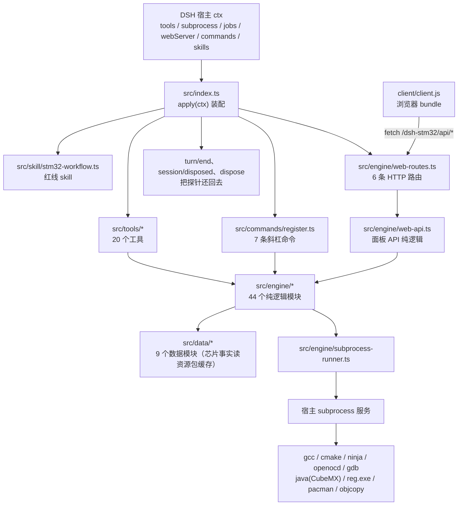

三个「入口」其实是同一件事的三种外壳：**模型调工具**（tools）、**用户打斜杠命令**（commands）、**用户在设置面板点按钮**（web-api）。三者最终都落到 engine 的同一批函数上，所以行为一致、错误文案一致、门禁一致。

### 1.1 目录与行数全景

| 目录 | 文件数 | 行数 | 说明 |
| --- | --- | --- | --- |
| src/ | 4 | 795 | index.ts 119、types.ts 196、commands/register.ts 445、skill/stm32-workflow.ts 35 |
| src/tools/ | 19 | 5078 | 20 个工具 + project-dir.ts（共同的工程目录/参数校验基础设施）；最大的是 route-plan.ts 573 行 |
| src/engine/ | 41 | 15919 | 见第 5 章；最大的是 msys2-install.ts 2313 行，其次是 clock-plan.ts 801 行 |
| src/data/ | 9 | 2336 | 9 个 .ts 数据模块（其中 device-facts.ts 从资源包缓存读设备事实，仓库里没有任何芯片表），见第 6 章 |
| templates/ | 17 | — | 工程脚手架与寄存器版模板（CMake、链接脚本、launch/settings、openocd.cfg、demo.ioc） |
| client/ | 1 | 682 | 设置面板的前端 bundle（手写 JS，不经打包器） |
| test/ | 31 套件 + 15 个 e2e 脚本 + 4 个辅助脚本 | — | 见第 9 章 |
| scripts/ | 4 | 349 | copy-client.mjs(18)、gen-xcube-catalog.mjs(136)、pack-size.mjs(63)、pack-smoke.mjs(132)。芯片表的生成脚本 2026-10-31 已挪到资源仓库（`scripts/build-assets.mjs`） |

## 2. 阅读顺序

不要从 engine/msys2-install.ts（2313 行）开始读，会迷路。按下面的顺序走，每一站都有一条完整的「从宿主到硬件」的链路可以跟到底。

| 站 | 读什么 | 行数 | 读完能回答 | 建议 |
| --- | --- | --- | --- | --- |
| 1 | src/index.ts、src/types.ts | 315 | 插件怎么被加载？宿主给了我什么？工具/命令/skill/路由各自怎么注册？ | 20 分钟 |
| 2 | src/tools/flash.ts → src/engine/flash.ts → src/engine/subprocess-runner.ts → src/engine/tool-env.ts | 915 | 一次工具调用从头到尾长什么样？参数怎么校验？进程怎么起、环境变量怎么注入？ | 1 小时 |
| 3 | src/engine/toolchain-gate.ts → probe.ts → src/data/search-roots.ts → src/data/toolchain-config.ts | 1649 | 门禁怎么判「缺件」？为什么快路径也要跑一次版本命令？配置文件的 CAS 写是什么？ | 1.5 小时 |
| 4 | src/engine/generate.ts → generate-script.ts → generate-cache.ts → layout.ts → ioc.ts → ioc-plan.ts → clock-plan.ts → code-patch.ts → text-file.ts → usercode-merge.ts | 3229 | CubeMX 怎么被驱动？产物怎么搬进 Core/？为什么改代码要按字节拼接？.ioc 事务的 SHA 校验挡的是什么？时钟怎么就近取档、目标不可达时怎么写？ | 3 小时 |
| 5 | src/engine/scaffold.ts → hal-chip.ts → register-template.ts → register-clock.ts → register-linker.ts → vscode-config.ts → build.ts → project-export.ts → zip.ts → fs-longpath.ts | 2798 | 新工程怎么造出来？两条路线为什么差别这么大（HAL 碰 CubeMX / 寄存器只用缓存）？型号怎么变成启动文件、设备宏和 `<DeviceId>_FLASH.ld`？编译产物 hex/bin 怎么来？ | 2.5 小时 |
| 6 | src/engine/fetch.ts → cache.ts → tar.ts → firmware-install.ts → thirdparty.ts → xcube.ts → msys2-install.ts | 4652 | sha256 门禁在哪一环？缓存怎么保证可恢复？固件包为什么装到 dsh-firmware？安装计划怎么做到只报缺件？ | 3 小时 |
| 7 | src/engine/debug.ts → debug-session.ts → regs.ts → doctor.ts → route-plan.ts → web-api.ts → client/client.js → src/commands/register.ts | 4082 | 调试会话的租约与归属怎么算？扫描链/寄存器怎么读？doctor 怎么核对型号/启动文件/.ld 是否配套？路线评估的判定规则？设置面板走什么通道？ | 3 小时 |

每一站的「流程」在第 7 章都有对应的图，读到不懂的地方先跳到图上找位置。

## 3. 入口层

### 3.1 src/index.ts（119 行）

三件事，只有三件：

1. **声明身份与依赖**：`export const name = "dsh-stm32"`、`export const inject = ["tools", "subprocess", "jobs"]`。这三个是硬依赖，缺了插件不加载。
2. **apply(ctx) 里按「先探测、再操作」的顺序注册 20 个工具**：env_probe → env_install → firmware_install → project_create → project_export → code_patch → generate → ioc_inspect → ioc_plan → ioc_apply → build → flash → debug_run → debug_session → regs_read → route_plan → cache → doctor → web_routes。顺序本身不影响功能（工具注册是平铺的），但排列是「用户上手顺序」。
3. **注册可选层并挂三个事件**：commands / skills 走 `ctx.inject([...], scope => ...)`，宿主没组合这些服务时静默跳过，工具照常工作；webServer 路由在`registerWebRoutes` 里自己判断。

三个事件是本插件唯一的「状态清理入口」，也是很容易读漏的地方：

```ts
ctx.on("session/event", (session, event) => {
  if (event?.type !== "turn/end") return;
  const owner = callerIdOf(event, session);   // A9：尽量挖出发起方 agent id
  void debugSessions.stop("turn/end：本轮输出结束，把探针还给你",
    owner === "" ? {} : { requireOwner: owner });
});
ctx.on("session/disposed", () => { void debugSessions.stop("session/disposed"); });
ctx.on("dispose", () => { void debugSessions.stop("插件卸载"); });
```

为什么要在 turn/end 就关会话：宿主把探针当独占资源，插件攥着它的时候用户在 VS Code 里按 F5 会失败。所以「我一输出完、等你回复」就必须松手（规格 §6.4）。`callerIdOf` 是本文件唯一的业务函数，它按「可能的位置逐个试」的方式从事件里掏 agent id——宿主没公开事件结构，掏不到就返回空串，debug-session 见到空串退回「无条件全关」的老行为，保证不漏关。

### 3.2 src/types.ts（196 行）

这不是「类型文件」，是**契约清单**。文件头注释写明了为什么自写：asar 里只有编译后的 JS，`@deepseek-ai/dsh-tools` 的类型装不到。所以这里只声明本项目真正用到的那部分。

读的时候注意四个坑（都是踩过的）：

| 契约 | 坑 | 后果 |
| --- | --- | --- |
| `SpawnSpec.cwd` | 宿主 subprocess 要求必填，不传直接抛 TypeError | 所有 engine 起进程都必须显式给 cwd |
| `SpawnSpec.stdio` | stdout/stderr 要写成 `{ maxBytes }` 才是收集式，否则拿不到输出 | 忘记 maxBytes 时报告里日志为空 |
| `SkillDefinition.source` | register 不校验，真正加载时才校验必须是字符串 | 漏了 source 的表现是 skill 出现在目录里，一加载就报 `loaded skill ... source must be a string` |
| `WebServerService` | 宿主没发布 IncomingMessage/ServerResponse 类型 | request/response 用 any，只在 web-routes.ts 里收口 |

### 3.3 src/skill/stm32-workflow.ts（35 行）

内容是一屏红线（R1–R5 + 12 条踩过的坑），运行时注册而不是打包成文件——「凡是能注册的服务就不要依赖路径约定」。口径已从「本机这块 C8T6」改成 **STM32F1 全系**（F100/101/102/103/105/107）：换型号必须启动文件、设备宏、链接脚本三者一起换，外加时钟跟着 line 的上限走。

- **R1** 代码只写在 `/* USER CODE BEGIN X */` 与 `END` 之间（CubeMX 承诺原样保留的唯一区域）。
- **R2** 不许改生成区（main()、MX_*_Init()、main.h 的 Private defines、*_hal_msp.c、*_it.c、CMakeLists、.mxproject、.ioc、以及本型号的启动文件与链接脚本）——理由很具体：这些文件由 .ioc 重写，手改会被无声覆盖且编译不报错。链接脚本按 `<DeviceId>_FLASH.ld` 命名（C8T6 → `STM32F103C8Tx_FLASH.ld`、RCT6 → `STM32F103RCTx_FLASH.ld`、F107VCT6 → `STM32F107VCTx_FLASH.ld`），旧名 `STM32F103XX_FLASH.ld` 只是 C8T6 的兼容副本。
- **R3** .ioc 只能走事务：`stm32_ioc_plan` → 用户确认 → `stm32_ioc_apply`，参数名是 **planId**（不是 plan_id），源文件 SHA-256 变了就拒绝。改时钟也走同一条事务（`clock: { targetHz }` 或钉死 `pllMul`）：目标频率不可达时报告写「不可达，已选 X MHz（±Y）」并把派生键（PLLMUL / SYSCLKFreq_VALUE / HCLKFrequency / APB1-APB2 prescaler）全量重算；超限（SYSCLK >72、APB1 >36、ADC >14）一个键都不写。
- **R4** 不许生成 No_Debug 的 SYS 配置（会关掉 PA13/PA14 的 SWD，烧一次就永久失联，只能 BOOT0 救）。
- **R5** 烧录与调试分开：flash 一次性 program-verify-reset-exit，debug_run 只在需要时开调试会话。

### 3.4 src/commands/register.ts（445 行）

七条斜杠命令：`/stm32-env`、`/stm32-setup`、`/stm32-doctor`、`/stm32-build`、`/stm32-flash`、`/stm32-debug`、`/stm32-stop`。

文件里真正值得读的是前面四个函数，后面全是 handler：

- `tokenizeCommandLine(rawInput): CommandToken[]` —— 引号感知切词（审计 B7）。一次扫描：引号内不切、顺手剥引号、记下 `quoted` 标记，这样 `--flag` 只有在没被引号包住时才算 flag。原来是「先按空白切再剥引号」，遇到 `"C:/Users/张 三/proj"` 会把路径切两段。
- `parseInvocation(ctx, invocation)` —— 把切出来的 token 变成工程目录 + 其余选项；`needSubprocess(ctx)` 拿不到进程服务时返回一句话错误而不是抛异常。
- `commandGateWarning(ctx, capability, signal, ...)` —— 命令侧的门禁是 **warn 不是 block**（审计 B8）：命令是用户手打的，缺件时应该「照常执行 + 前置一行警告」，而不是拒绝。
- `withGateWarning(warning, result)` —— 把警告行拼到 `CommandResult.text` 前面。

7 条命令里有 6 条最终调用 engine 的同一个函数（build → runBuild，flash → runFlash …），所以它们和工具的唯一差别是：输入来自文本而不是 JSON、输出是一段中文。

## 4. tools 层：20 个工具 + 1 个基础设施

### 4.1 一个工具文件的固定骨架

以 src/tools/flash.ts（185 行）为例，每个工具都是同一个模子：

```ts
export const FLASH_TOOL = "stm32_flash";           // 1. 名字常量（测试与命令复用）
const reportSchema: JsonSchema = { ... };           // 2. 输出报告 schema（additionalProperties: false）
export const outputSchema: JsonSchema = { schema: reportSchema, render: formatFlashReport };

export function registerFlash(ctx: DshContext): void {
  ctx.tools.register({
    name: FLASH_TOOL,
    description: "...",
    parameters: { ... },                            // 3. 参数 schema
    output: outputSchema,
    async execute(args, exec) {                     // 4. 校验 → 门禁 → engine → 渲染
      const projectDir = await resolveProjectDir(ctx, args.projectDir, exec);
      const gate = await ensureToolchain(ctx, { capability: "flash", envCheck: args.envCheck, signal: exec.signal });
      if (!gate.ok) return blockedReport(projectDir, gate);
      const report = await runFlash(ctx.subprocess, { ... });
      return report;
    },
  });
}

export function formatFlashReport(report: FlashReport): string[] { ... }  // 5. report → 中文行
```

三个细节值得记住：

1. **输出 schema 是硬的。** 宿主会拿 `output.schema` 校验 execute 的返回值，report 上任何没声明的字段都会被判「工具返回了非法输出」——这正是 0.1.2 上板时抓到的缺陷（flash 失败时带一个故障分类字段，而 schema 漏声明它，于是失败路径直接崩；这个字段在 B2 之后叫 `probeError`，见 §5.4）。改 report 结构必须同步改 schema，test/schema-guard.mjs 就是为这条存在的。
2. **门禁在工具层，不在 engine。** engine 假设工具链就位；`blockedReport` / `emptyReport` 是门禁拦截与早退时造「同形报告」的工厂，保证失败也是合法输出。
3. **`resolveProjectDir` + `validateToolArgs`（tools/project-dir.ts，120 行）是所有工具的共同入口**：前者把 `projectDir` 参数 / 会话工作目录落成绝对路径，后者按 `RequiredArgSpec` 校验必填参数类型，报错文案统一。

### 4.2 20 个工具一览

| 工具 | 文件（行） | engine 入口 | 门禁能力 |
| --- | --- | --- | --- |
| `stm32_env_probe` | env-probe.ts（284） | probe.buildTargets / probeAll + search-roots.resolveSearchConfig | 无 |
| `stm32_env_install` | env-install.ts（550） | msys2-install.planOrInstallMsys2 | 无 |
| `stm32_firmware_install` | firmware-install.ts（288） | firmware-install.planOrInstallFirmware | 无 |
| `stm32_project_create` | project-create.ts（344） | scaffold.createProjectScaffold（型号 → hal-chip 渲染启动文件/设备宏/.ld/.ioc）/ register-template.createRegisterProject | build（仅 register 路线；hal 路线降级成 warnings） |
| `stm32_project_export` | project-export.ts（122） | project-export.runExport | 无 |
| `stm32_code_patch` | code-patch.ts（130） | code-patch.patchUserCode | 无 |
| `stm32_generate` | generate.ts（308） | generate.runGenerate | generate（CubeMX 启动器 + JRE） |
| `stm32_ioc_inspect` | ioc-inspect.ts（241） | ioc.summarizeIoc | 无 |
| `stm32_ioc_plan` | ioc-plan.ts（395） | ioc-plan.planIocChanges + clock-plan.planClockChanges（引脚 / 键 / 时钟进同一个 candidate） | 无 |
| `stm32_ioc_apply` | ioc-apply.ts（135） | ioc-plan.applyIocPlan / rollbackIoc | 无 |
| `stm32_build` | build.ts（243） | build.runBuild | build（gcc + cmake + ninja） |
| `stm32_flash` | flash.ts（185） | flash.runFlash | flash（openocd） |
| `stm32_debug_run` | debug.ts（211） | debug.runDebugRun | debug（openocd + gdb） |
| `stm32_debug_session` / `_eval` / `_stop` | debug-session.ts（265，三工具同文件） | debug-session.DebugSessionManager（单例 debugSessions）+ releaseProbeFor | debug（仅 session 启动时） |
| `stm32_regs_read` | regs.ts（218） | regs.runRegsRead | debug |
| `stm32_route_plan` | route-plan.ts（573） | engine/route-plan.assessRoute + toolchain-gate | register-ok → build；其余 → generate；unclear → 不查 |
| `stm32_cache` | cache.ts（274） | engine/cache 全套 | 无 |
| `stm32_doctor` | doctor.ts（192） | doctor.runDoctor + collectChipConsistency（型号/启动文件/设备宏/.ld/Flash 五项一致性） | 无（它自己就是体检） |
| —（基础设施） | project-dir.ts（120） | resolveProjectDir / validateToolArgs | — |

两个「不像工具」的文件：**debug-session.ts 一个文件注册三个工具**（会话开 / eval / stop 共享同一份会话表，所以必须同文件）；**route-plan.ts 573 行**是 tools 层里最大的，因为它的输出 schema 要装下「逐外设代价矩阵 + 安装指引 + 缺件清单」三大块。

## 5. engine 层：44 个模块，十个域

下面按「读代码时会被一起找到」分组。每个模块给：行数、职责、关键导出、谁调用。表里列 44 个；`src/engine/` 目录里实际有 45 个 `.ts`——`assets.ts`（资源包装配的小件）还没单独成行，读资源包那条链路时直接从 §5.7 与 `src/data/assets` 一起看。

### 5.1 进程与路径（3 个，413 行）

| 模块 | 职责与关键导出 |
| --- | --- |
| subprocess-runner.ts（250） | 全插件唯一的进程入口。`runCapture(subprocess, request): Promise<RunOutcome>` 收集输出（stdout/stderr 文本、exitCode、signal、spawnError、timedOut、aborted、awaitQuiescence）；`runStreaming(subprocess, request, onText)` 边跑边推。两处「注入 env」（审计 B4）就在这里：把 `envWithBinDirs` 的结果塞进 SpawnSpec，否则刚用 stm32_env_install 装好但宿主没重启时，门禁说「齐全」而 cmake 报 arm-none-eabi-gcc not found。 |
| tool-env.ts（56） | `envWithBinDirs(binDirs, base)`：binDirs 去重去空后**拼在原 PATH 前面**，Windows 上只留一个大小写正确的 `Path` 键；`toolSearchDirs(binDirs, base)` 给出「去哪找可执行文件」的有序目录表。 |
| fs-longpath.ts（107） | 长路径工具。`toLongPath` 加 `\\?\` 前缀、`existsLong`、`mkdirTrackedLong`（顺手记下新建的目录，失败时回收）、`copyFileLong`、`copyTreeLong`、`describeCopyFailure`。固件包的 Drivers/CMSIS/Device/ST/STM32F1xx/Source/Templates/gcc 这种深度在长用户名下会撞 MAX_PATH（审计 B17）。 |

### 5.2 探测、搜索与门禁（engine 2 个 + data 2 个，1649 行）

| 模块 | 职责与关键导出 |
| --- | --- |
| probe.ts（363） | 「找一个可执行文件并问它版本」。`ProbeTarget`（id/label/candidates/versionArgs/hint/impact/install/verify/installability）、`resolveFromDirs` / `resolveToolIn`（先按 binDirs 找，再按需回退到宿主 resolveExecutable——回退由 `ProbeOptions.allowPathFallback` 控制，安装自检时关掉，防「用 PATH 里的旧工具冒充刚装好的」）、`probeTarget` / `probeAll`、`msys64RootFromBinDirs`、`buildTargets(config)`（把 SearchConfig 变成 9 个探测目标）。 |
| toolchain-gate.ts（495） | 门禁本体。`ToolchainCapability = build/flash/debug/generate`、`CAPABILITY_COMPONENTS`（build→gcc,cmake,ninja；flash→openocd；debug→openocd,gdb；generate→cubemx,cubemx-java）、`EnvCheckMode = block/warn/off`、`ensureToolchain`、`gateReportNotes`、`gateBlockedMessage`、`resetGateCache`。内部两条路：**快路径**（文件都在 → 再跑一次「主组件」的版本命令 smokeTarget，60 s 缓存）；**慢路径**（全量 probeAll，结果缓存 60 s，取消时**不写缓存**——审计 A27）。 |
| data/search-roots.ts（421） | 搜索范围的事实表。DEFAULT_BIN_DIRS / DEFAULT_CUBEMX_ROOTS、discoverBinDirs / discoverCubeMxRoots（含 msys64 的 ucrt64/mingw64/clang64 变体）、`decodeRegistryText`（严格 UTF-8 不成就按 GB18030 解，审计 B9）、`readRegistryInstallDirs`、`resolveSearchConfig`（配置 > 显式 > 自动发现）、`searchConfigWarnings`、`describeSearchScope`。 |
| data/toolchain-config.ts（370） | ~/.dsh-stm32/config.json 的读写。`TOOLCHAIN_CONFIG_VERSION = 1`、`ToolchainConfig{msys64,binDirs,cubeMxRoot,packages}`、`readToolchainConfig`、`writeToolchainConfig(expect)` 与 `updateToolchainConfig`（CAS：写入前比对快照，别人改过就冲突而不是覆盖，审计 A28）、`binDirsFromConfig` / `cubeMxRootsFromConfig`、`describeToolchainConfig`。 |

### 5.3 构建与产物（2 个，543 行）

| 模块 | 职责与关键导出 |
| --- | --- |
| build.ts（493） | `runBuild(subprocess, request)`：选 preset（`pickConfigurePreset` 优先 Debug）→ `cmake --preset` → `cmake --build` → `findElf`（= `pickElf`：CMakeCache 的 CMAKE_PROJECT_NAME 优先，否则取 mtime 最新的 .elf；`elfCandidates` 列出全部候选，`elfSelectionNote` 在候选多于 1 个时把「选了哪个、其他候选的 mtime」写进 notes）→ 解析内存占用（`parseMemoryUsage`，GNU ld 的 `RAM: 1584 B 20 KB 7.73%` 格式）→ 错误行（`parseBuildErrors`）与警告数（`countWarnings`）→ 按需跑 objcopy 出 hex/bin（`converted`，失败只写 note 不判失败）。辅助导出：`presetDirs`、`detectBuildDir`。 |
| layout.ts（50） | 生成物的落位约定：`GEN_SRC_DIR = "Src"`、`GEN_INC_DIR = "Inc"`、`PROJECT_SRC_DIR = "Core/Src"`、`PROJECT_INC_DIR = "Core/Inc"`、`mapGeneratedPath(rel)`、`listGeneratedFiles`。CubeMX 无头模式吐在 `.dsh-stm32/gen/Src|Inc`，由这里映射回工程的 Core/。 |

### 5.4 烧录、调试与诊断（8 个，3160 行）

| 模块 | 职责与关键导出 |
| --- | --- |
| flash.ts（424） | `runFlash`：SWD 守卫（`checkNoDebugGuard`：唯一 .ioc 看 PA13/PA14，没有 .ioc 就看 openocd.cfg 的 transport，找不到依据时给 notes 而不是静默放行）→ `resolveElf` → 找 openocd 配置（`findProjectConfig` 认 openocd.cfg/openocd/…；否则 `defaultConfigs` 用 interface/cmsis-dap.cfg + target/stm32f1x.cfg）→ 拼 `program <elf> verify reset exit`（`buildProgramCommand`）→ 解析日志（`parseFlashLog` 只回答 programmed / verified / errors / noise，**不再归类**）→ 失败时只调一次 `classifyProbeFailure`（stage "flash"），产物是 `probeError: ProbeError | null`（成功路径保持 null，由工具层摘掉）→ USB 形态提示（`usbNoteFor` / `probeMissingLines`）。`toOpenOcdPath` 只把反斜杠换成正斜杠。B2 之后分类规则与 hint 常量只在 probe-error.ts 一份，flash 与 debug 不会再各写一套漂移。 |
| debug.ts（406） | 一次性调试快照 `runDebugRun`：挑端口（`pickPort`，默认 3333，占用则顺延）→ 起 openocd（`waitForListening` 等 "Listening on port"）→ 起 gdb 跑一串 -ex（file / break / info registers / bt / info locals / monitor reset run / detach）→ `parseGdbOutput` 提取断点命中、寄存器、调用栈、locals → ok 判据看 exitCode + probe.errors + hitBreakpoint（审计 A26）。失败时：`classifyProbeFailure` 归类（与 flash 同一个函数、同一组 kind，stage "debug"）→ `probeMissingLines` 命中就跑 `usbDiagnosis`、日志用 `keyLogTail(lines, 40)`（优先留 adapter/Error 行，而不是「最后 15 行」）、`firstProblemLine` 把首条根因塞进 errors、kind 不是 unknown 时把 hint 写进 notes。B4 的断点预算（`resolveBreakpointBudget` / `collectBreakpointRequests` / `planBreakpoints`）也在同一条 execute 里先算完，报告带 `breakpoints` / `watchpoints` 两个 used/limit/remaining 三元组。 |
| debug-session.ts（516） | 长会话租约。`DebugSessionManager` 管「一个常驻 openocd + 多次短命 gdb -batch eval」，空闲 90 s、总时长 10 min、turn/end 立刻释放；`releaseProbeFor(reason)` 是别的工具（flash/regs/debug_run）动探针前必须调的一步（审计 B16：先释放再门禁）。三个纯函数是好单测点：`normalizeHexAddress`、`parseGdbPrintedHex`、`parseMarkedWords`（按 `echo ===DSH:<tag>===` 分段对齐，修「中间某个地址读失败导致后面值整体前移」）。 |
| regs.ts（246） | 读内存映射寄存器。`normalizeAddress`（0x 可省）、`buildRegsScript`（生成 openocd 脚本：init → halt → mdw）、`parseRegsLog` → `runRegsRead`。本身只负责脚本生成与日志解析（`buildRegsScript` / `parseRegsLog`，不复位芯片）；B3 起工具层换成「复用常驻会话 + Tcl RPC 直读」（`ensureSession` + `readWordsViaSession`，RPC 失败回退到会话里的 gdb），没有会话时才起一个并保留 90 s。 |
| probe-error.ts（257） | 探针故障的**唯一分类入口**（B2）。`ProbeErrorKind` 8 类（no-probe / probe-busy / swd-locked / flash-protected / no-power / target-mismatch / timeout / unknown）、运行期枚举 `PROBE_ERROR_KINDS`、`ProbeError{kind,cause,hint,evidence,retryable}`；`classifyProbeFailure({lines,exitCode,stage,timedOut,spawnError})` 的判定顺序是 **MATCHERS 首个命中 → timedOut（timeout） → spawnError → unknown**，所以 MATCHERS 的顺序是敏感的。hint 常量（`HINT_PROBE` / `HINT_BUSY` / `HINT_DP` / `HINT_FLASH_PROTECTED` / `HINT_NO_POWER` / `HINT_TARGET_MISMATCH` / `HINT_TIMEOUT` / `HINT_UNKNOWN`）只此一份；`firstProblemLine` / `probeMissingLines` / `usbNoteFor` 从 flash.ts 迁过来；`formatProbeError` 出「错误：<kind> — <cause>；建议：<hint>」；`PROBE_ERROR_SCHEMA`（additionalProperties:false，五个字段全 required）。不做兼容别名：`errorCode` 字段已删除，flash / debug / session 三条路径共用同一份规则。 |
| probe-session.ts（365） | 会话复用的快路径（B3）。`sessionInfo` / `touch` / `release(reason)` / `ensureSession(projectDir, opts)` / `withSession` / `readWordsViaSession({addresses})`，以及纯函数 `normalizeWordAddress` / `parseMdwReply` / `parsePcReply` / `tclRoundTrip`。会话的唯一真相仍是 debug-session.ts 的 `debugSessions` 单例——这里不自己存句柄、也不自己算租约；并发靠模块级 starting Promise 去重（同时两次调用只起一个进程）；端口被占直接报 `probe-busy`，不让 openocd 顺延端口去抢探针。读值走 openocd 的 Tcl RPC、一条 TCP 连接（halt → `reg pc` → `mdw`×N → resume，用 0x1a 分帧），tcl 端口没拿到或 RPC 失败就回退到会话里的 gdb 并写 notes。 |
| breakpoints.ts（281） | 断点预算（B4）。`BreakpointBudget{code,data}`、`F1_BREAKPOINT_BUDGET = {code:6, data:4}`、`quotaOf(used, limit)`（used 夹在 [0,limit]，给出 used/limit/remaining 三元组）、`budgetFromChipFact`、`readIocCpn`、`resolveBreakpointBudget(projectDir)`（.ioc 的 Mcu.CPN → chips.json 里可选的 breakpoints/watchpoints；没 .ioc、chips.json 没这颗、或没写值都回退 F1 6/4 并说明原因）、`parseBreakpointSpec` / `breakpointFromGdbCommand`、`collectBreakpointRequests({breakAt,breakpoints,preCommands})`（preCommands 里的 break / watch 也计数，同 kind+location 去重）、`planBreakpoints` 出 detail + suggestion。超限在 spawn openocd **之前**就失败，不碰探针、也不关已有会话。 |
| doctor.ts（665） | 体检 + 配套性核对。`runDoctor`：逐组件探测 + 进程残留（`parseTasklistCsv` 认 openocd/gdb）+ 端口占用（`checkPortBusy`）+ .ioc 告警 + USB 形态（`usbDiagnosis` / `diagnoseUsb`：只认行内 ASCII 本体，因为中文系统的 pnputil 字段名是 GBK 乱码）+ elf/构建目录；最后跑 **checkChipConsistency / collectChipConsistency** 的五项一致性：① 型号 ↔ 启动文件名 ② 启动文件 ↔ cmake 设备宏 ③ `.ld` MEMORY 容量 ↔ 芯片实际容量 ④ `.elf` Flash 占用 ↔ Flash 容量 ⑤ .ioc 用到的引脚是否在封装内。配套纯函数 `parseLinkerMemory`（认 20K / 0x5000 / 65536，算式不算）、`deviceDefinesIn`、`elfFlashBytes`（读 ELF program header，只累加 `p_paddr` 落在 0x08000000 起 1 MiB 的 PT_LOAD 的 `p_filesz`）、`findLinkerScript` / `linkerScriptNames`（多个 .ld 时优先非 STM32F103XX_FLASH.ld 的那个）。 |

### 5.5 生成、编码、.ioc 事务与时钟（10 个，3659 行）

| 模块 | 职责与关键导出 |
| --- | --- |
| generate.ts（750） | 全仓库最复杂的一个。`STATE_DIR = ".dsh-stm32"`、`findIocFile`（只认「唯一」.ioc）、`detectLayout`（coupled / per-ip）、`runGenerate`：工程锁（`acquireLock`：pid + startedAt + `isProcessAlive` 探活，30 分钟兜底）→ 固件包定位 → 生成 CubeMX 脚本（`-Dfile.encoding=UTF-8`，审计 B18）→ 跑 CubeMX → 解析日志（generate-script.parseGenerateLog，以产物判据为准）→ 把 Src/Inc 搬进 Core/（preserve USER CODE）→ `assessGenerateProducts`（产物判据：applied 数为 0 或关键文件缺失时 ok 不能为真）→ 写 generate-cache → 落位后（以及缓存命中直接返回前）再跑一次 `refreshCubemxCmakeLists`，把 `cmake/stm32cubemx/CMakeLists.txt` 对齐磁盘上的 startup 与 hal_conf。 |
| generate-script.ts（115） | `buildGenerateScript` 拼脚本（setCustomFWPath / SetCopyLibrary / ProjectManager 项）、`layoutCommand`、`parseGenerateLog`：UNKNOWN_COMMAND 先判；成功行不再「一票否决」错误（审计 A10）——CubeMX 缺包时也会打 Code successfully generated，所以 ok 由产物判据决定。 |
| generate-cache.ts（168） | 生成缓存。`CACHE_FILE = "generate-cache.json"`、`sha256Text` / `sha256File`、`cubeMxStamp`、`computeCacheKey(iocSha, stamp, layout)`、`readCache` / `writeCache`、`cacheHit(entry, key, projectDir)`（key 命中还不够，文件 hash 也得对得上）。 |
| usercode-merge.ts（142） | `parseUserCodeRegions` / `mergeUserCode` / `canMergeUserCode`：把旧文件 USER CODE 块里的内容搬进新生成的文件，保留 CRLF 风格，标出 droppedLabels。 |
| code-patch.ts（215） | `patchUserCode`：只改一个 USER CODE 块（replace / append），块内出现 `{` 或 `}` 拒绝（结构行守卫），写前备份，写回**按字节拼接**（见 text-file）。`listUserCodeLabels` 列出可用标签。 |
| text-file.ts（172） | 编码层。`detectEncoding`（BOM → utf8-bom；空 → utf8；严格 UTF-8 成 → utf8；再试 gb18030；否则 unknown）、`decodeText`、`encodeText`（gb18030 只允许纯 ASCII——Node 只有解码器没有编码器）、`readTextFile`、`lineStarts`、`replaceLineRange`（未改的行原字节照抄，只把新增行按原编码插入）。**这是「中文注释不被写坏」的唯一保障**。 |
| ioc.ts（202） | .ioc 只读解析：`parseIocEntries`、`decodeIocValue`、`summarizeIoc`（MCU、时钟树、引脚、外设、调试口、工程设置、警告）。 |
| ioc-plan.ts（614） | .ioc 事务。`planIocChanges` 算出逐键 diff + 源 SHA-256 → planId；`applyIocPlan` 校验 SHA 后原子替换（备份到 backups/<stamp>-ioc）；`rollbackIoc(backupFrom)` 回滚；辅助 `renderIocText`、`compareEntries`、`sha256Hex`、`encodeIocValue`、`loadPlan`。引脚写入保序（审计 A3）：只追加新增，不因缺 .Signal 删已有项。 |
| clock-plan.ts（801） | 时钟规划（t3 新增）。`planClockChanges`：枚举 PLL 源 × 倍频 × 分频的全部可行组合 → 取 `|sysclk − target|` 最小（同距取更高档，所以 60 MHz 的目标落在 64 MHz，报告里写「不可达，已选 64 MHz（+4 MHz）」）→ 与 .ioc 现有键做 diff，`PLLMUL`、`SYSCLKFreq_VALUE`、`HCLKFrequency`、`APB1/APB2Prescaler` 这些派生键**全量重算**（只改源键会让 CubeMX 按旧频率理解）→ 再给逐外设频率表与 UART 波特率整除误差。`mode` 四态：`snapshot`（只看不写）/ `nearest`（默认就近）/ `explicit`（钉死 pllMul）/ `none`。超限（SYSCLK >72、APB1 >36、ADC >14）时**一个键都不写**，只报错。参数化在 src/data/clock-f1.ts。 |
| cmake-sources.ts（480） | **老洞的补丁**：CubeMX 无头生成从不重写 `cmake/stm32cubemx/CMakeLists.txt`，那份源清单永远停在脚手架快照上。`collectCmakeSources` 从磁盘反推真相（`pickStartupFile` 选启动文件 → `deviceDefineFromStartup` 得 `STM32F103xB` → `familyTokensFromStartup` 得家族目录 `STM32F1xx` → `halModulesInUse` 由 `stm32f1xx_hal_conf.h` 的 `HAL_xxx_MODULE_ENABLED`（先 `stripComments`，注释掉的不算）∪ `Core/Src` 源码里的 `#include "stm32f1xx_hal_x.h"` 求并集），`refreshCubemxCmakeLists` 只重写三个 managed 块（设备宏 / 应用清单 / 驱动清单），保留原顺序、摘掉磁盘上已不存在的条目、缺的追加到末尾；`dominantEol` 按多数行尾写回、内容一致时一个字节都不写；`describeRefresh` 生成一句人话进 generate 的 notes。 |

### 5.6 造工程、链接脚本与导出（8 个，2198 行）

| 模块 | 职责与关键导出 |
| --- | --- |
| scaffold.ts（518） | HAL 路线脚手架。`preflightTarget`（工程名合法 → 目录非空 → hal 且已有同名 .ioc 就拒绝，指向 ioc_plan/apply）、`backupBeforeOverwrite` + `backupWarning`（只备份真会被覆盖的文件）、`mkdirTracked` / `cleanupAfterFailure`（失败只回收本次新建）、`resolveFirmwareRoot`（Repository → dsh-firmware → extraDirs）、`createProjectScaffold`、`templateDir`、常量 `DEFAULT_FIRMWARE_PACKAGE` / `SCAFFOLD_PROJECT_NAME`。复制走 fs-longpath。型号相关的启动文件、设备宏、`<DeviceId>_FLASH.ld` 与 demo.ioc 由 hal-chip 在**写盘之前**渲染成字符串，渲染失败时一个字节都不写。 |
| hal-chip.ts（284） | HAL 路线的「型号 → 生成物」派生与纯文本渲染（t1 新增）。`resolveHalChip(input)` 复用 F1Chip，`renderStartupAndDefine`（RCT6 → startup_stm32f103xe.s + STM32F103xE）、`renderLinkerScript`（把 STM32F103XX_FLASH.ld 的 MEMORY 两行与注释两行换成 `<DeviceId>_FLASH.ld`，RCT6 是 256 KiB / 48 KiB）、`renderIoc`（demo.ioc 的 Mcu.CPN、引脚、时钟键）、`pointLinkerFlagAt`（把工具链文件里写死的 `-T STM32F103XX_FLASH.ld` 改指新名，否则命令行上会出现两个 -T）。全是字符串函数，所以能先渲染后落盘。 |
| register-template.ts（558） | 寄存器路线（不碰 CubeMX）。`resolveStartupChoice`（按型号/族选启动文件与宏）、`ensureCmsisTemplate`（从镜像下载 10 个文件到缓存并校验 sha256）、`createRegisterProject`（拷模板 → 写设备头/启动文件/链接脚本 → 生成 main.c）。模板文件缺失分「必需」与「可选」（.gitignore 是可选，缺了给 warning 不阻断）。模板里已不写死任何型号：启动文件、设备宏、设备头、`.ld`、时钟全部按 `resolveF1Chip` 的结果参数化（14 个容量档）。 |
| register-clock.ts（261） | 寄存器版的时钟初始化代码生成（不碰 CubeMX）。按 line 取最高 SYSCLK：F100 24 / F101 36 / F102 48 / F103·F105·F107 72 MHz；HSE 8 MHz ×N（F101 走 HSE/2×9 凑 36 MHz）；FLASH latency 按频率给 0/1/2（F100 的设备头里没有 latency 字段，自动跳过）；APB1 在 >36 MHz 时 ÷2；HSE 起不来就退 HSI/2×N 并写警告。产出的 `clock_init()` 插在 main() 第一行，末尾 `SystemCoreClockUpdate()` 让 SysTick 与 delay_ms 跟着对。 |
| register-linker.ts（152） | 寄存器版的链接脚本渲染：按型号换掉 `<DeviceId>_FLASH.ld` 的 MEMORY RAM/FLASH 两行。F100/F101/F102 的 RAM 不在 src/data/stm32f1.ts 的表里，用 CubeMX db 的最小值兜底**并明确警告**（宁可小——栈必须留在真 RAM 内）。 |
| vscode-config.ts（118） | `VSCODE_PLACEHOLDERS`（gdb / toolchain / cmake / svd 四个占位符）、`detectVscodeFill`（按本机探测结果填）、`fillVscodeTemplate`（没值的整行删掉并记 dropped，绝不写空串）、`describeDroppedPlaceholder`。模板里因此不出现任何开发机绝对路径（审计 B1）。 |
| project-export.ts（155） | `runExport`：收集源文件（跳过 build / .dsh-stm32 / node_modules / .git）→ 可选带 prebuilt（elf/hex/bin）→ 可选内联 README → 打 zip。 |
| zip.ts（152） | 自写的最小 store-only zip（不压缩、不引依赖）：`crc32`、`makeZip`、`listZipEntries`（测试用来验内容）。 |

### 5.7 下载、缓存与固件包（7 个，2456 行）

| 模块 | 职责与关键导出 |
| --- | --- |
| fetch.ts（347） | `fetchOne(target, destRoot, options)`：按 URL 列表依次尝试 → 校验内容特征（markers）→ 校验 sha256（有声明时）→ 落到目标路径；`fetchAll` 汇总。失败信息带「期望 / 实际」两个哈希，方便判断是上游挪了内容。**同一源内断点续传**（F3c）：`streamOnce(url, part, startAt, …)` 用 `Range: bytes=N-` 流式写 `.part-<pid>-<seq>`，watchdog 在 `stallMs`（默认 10 s）内判停滞或平均速率 < `minBytesPerSec`（默认 1024）就 abort，返回 `slow: true` 让 `fetchOne` 从已落盘字节续一次；服务器回 200（无视 Range）时截断重写，只有 206 才追加——**换源一律从零开始**（不同源的字节不保证同一份）。**校验失败必须连 `.part` 一起删**（T1 实测抓到的泄漏）：体量 / 网页 / markers / sha256 四道都不通过时走局部 `reject(reason)`——它把失败原因记进 `attempts` 再 `removeQuietly(part)`，否则半成品会长期躺在缓存目录里等着占满磁盘。 |
| cache.ts（370） | 缓存索引（默认 %LOCALAPPDATA%\dsh-stm32\cache，可用 DSH_STM32_CACHE 覆盖）。`CACHE_INDEX_VERSION`、`readCacheIndex` / `writeCacheIndex`（坏索引先改名 index.json.broken-<ts>；tmp 唯一名 + rename 失败先备份旧索引再重试；`CacheIndexWriteError` 让上层知道是索引写坏了，审计 A2/A12）、`upsertCacheEntry` / `removeCacheEntry` / `findCacheEntry`、`checkCacheEntry`（按 sha256 验证，审计 A38）、`sha256OfFile`、`describeCacheBytes`。 |
| tar.ts（288） | `extractTarGz(archive, destRoot, options)`：解 gzip + tar，路径白名单（`isSafeRelative` 拒反斜杠、冒号、.. 与空段）、类型白名单（`entryKind`：0/空/5 正常，x/g/L/K 元数据，其余跳过并记名，审计 A4）、声明长度超出实际数据判截断整次失败。 |
| firmware-install.ts（760） | 固件包下载与组装。`firmwareInstallPlan` / `installFirmware` / `planOrInstallFirmware`：选址（`isProtectedSystemDir` 拒绝 Program Files 之类、`orderCubeMxRoots` 把本机存在的排前面、`hasCubeMxExe` 只对真 CubeMX 目录建 dsh-firmware）→ 下载 2 个归档 + 5 个内核头 → `extractTarGz` → `verifyFirmwarePackage` → 写 `installed.json` 记录（`FIRMWARE_RECORD_FILE`）→ `firmwareExtraDirs` 让 generate/scaffold 也能找到非标准落点。 |
| thirdparty.ts（281） | 生成期间临时停放 CubeMX 的第三方包索引（`PARKED_NAME = "pdsc.dsh-parked"`、`needsThirdpartyPacks`、`parkThirdpartyDb`），有 X-CUBE 包的工程保持原样；`cubeMxUserHome`。 |
| xcube.ts（293） | X-CUBE 包识别：`identifyPackId`、`parsePdscNames`、`listInstalledPacks`、`scanIocPacks`、`summarizePacks`。 |
| xcube-catalog.ts（117） | 由 scripts/gen-xcube-catalog.mjs 生成的包目录（159 条）。`XCUBE_CATALOG_ENTRY_COUNT = XCUBE_PACK_CATALOG.length`（审计 A23：不要把条目数写成数字常量，重跑脚本会回写旧值）。 |

### 5.8 工具链安装（1 个，2313 行）

| 模块 | 职责与关键导出 |
| --- | --- |
| msys2-install.ts（2313） | 最大也最脏的一块：下载 MSYS2 安装包 → 静默安装 → pacman 装 5 个组件 → 写用户级 PATH → 写配置 → 自检。关键导出：`MSYS2_INSTALLER_URL` / `MSYS2_INSTALLER_BYTES`、`DEFAULT_MSYS2_PACKAGES`、`MSYS2_SUGGESTED_ROOT`、`planOrInstallMsys2(subprocess, request)`（plan / install 两条路）、`msys2StepSkeleton`、`parsePacmanQuery`、`resolveInstallerUrls(env)`（**F3a 候选链**：`MSYS2_INSTALLER_URL` 单源 > `MSYS2_MIRROR` > 清华 TUNA / 中科大 USTC / 南大 NJU / 阿里云 × 两个文件名 > GitHub，共 10 个候选；`installerSourceLabel` 把 URL 变成「清华 TUNA」这样的人话）、`installerSourceLabel`、`preferMirrorServers(text, servers)` / `preferChinaMirrors(msys64)`（**F3b**：只把国内镜像插到 `etc/pacman.d/mirrorlist.msys` 与 `mirrorlist.mingw` 最前，官方条目不删，幂等，已有 MSYS2 一个字都不改）、`resolveTargetDir` / `viaLabel`、`formatBytes`、`isDriveRoot` / `ensureParentDir`（盘根不能 mkdir，审计 ③）、`usageNote` / `planMessage`（**计划模式只报缺件**：已装齐时 steps 为空、download.bytes 0、一句话收尾）。**F3d 三道粗检**：缓存要 MZ 头 + ≥ `MIN_INSTALLER_BYTES`（40 MB）才算数（`cachedInstallerBytes`）；下载后查退出码/体量/MZ；解压后再查 `<msys64>/usr/bin/bash.exe`，缺了就把坏缓存改名 `.broken`（不删）。**F3c**：`curl -C -` 同源续传、`--speed-limit 1024 --speed-time 10` 低速自退（退出码 28 单独说明），退出码 33（服务器不支持 Range）去掉 `-C -` 重下一次，换源前删 `.part`。 |

### 5.9 设置面板的宿主侧（2 个，577 行）

| 模块 | 职责与关键导出 |
| --- | --- |
| web-api.ts（477） | 六条路由的**纯逻辑**（不碰 http 对象，所以可单测）。`WEB_API_PREFIX = "/dsh-stm32/api"`、`WEB_API_PATHS`（/config、/config/save、/probe、/install/plan、/install/start、/install/state）、`configSnapshot`、`saveConfig`、`probeTools` / `summarizeProbe` / `capabilitiesOf`、`installPlan`、`installStart` / `installTaskState`（进程内任务表，留 20 个，日志尾巴 200 行）、`handleWebApi`（分发 + 请求体 JSON 校验，1 MB 上限在 web-routes）、`resetInstallTasks`。 |
| web-routes.ts（100） | 薄适配层：`ctx.inject(["webServer"], ...)` 里 `server.register({ kind: "exact", path, handler })`，把 request/response 收成 `handleWebApi` 的输入输出，加 `cache-control: no-store`。宿主没 webServer 服务时静默跳过（面板不可用，工具照常）。 |

### 5.10 路线评估（1 个，645 行）

| 模块 | 职责与关键导出 |
| --- | --- |
| route-plan.ts（645） | 「这笔功能该走 HAL 还是寄存器」。`PERIPHERAL_RULES`（外设规则表：关键词 → HAL/寄存器各自的代价与风险）、`assessRoute(input)` → `RouteAssessment`（verdict：hal-only / both-viable / register-ok / unclear）、`familyOf`、`findFirmwarePackage`、`VERDICT_LABEL`。工具层再把它和门禁、安装指引拼成一份输出。 |

## 6. data 层：9 个数据模块（2336 行；芯片事实来自资源包缓存，仓库里没有芯片表）

| 模块 | 行数 | 内容 |
| --- | --- | --- |
| chips.ts | 142 | **不再有内置引脚表**（`CHIPS` / `KNOWN_CHIPS` / `findChip` 2026-10-31 删除）。`isKnownPin(pin)` 只查**引脚名是否合法**（`PA0..PG15`、`VP_*` 虚拟脚放行；顺序不影响——`PA0-WKUP` / `PC13-TAMPER-RTC` 先归一化）；这不是「这个封装有没有这根脚」，那条事实只能来自本机 CubeMX db：`parseMcuDbXmlPins`（`<Pin Name= Position=>`，`Position<=0` 的虚拟脚丢弃，电源脚不算）、`findMcuDbDir`（`<CubeMX>/db/mcu`）、`readMcuDbPins`、`deriveChipPinTable({cpn, mcuName, dbMcuDir})` → `kind: db / unknown`（db 命中注明来源 XML 与引脚数；没有 db 就明说「引脚存在性不校验」，绝不拿内置表冒充）。 |
| cmsis-sources.ts | 341 | 寄存器路线的下载源与型号映射：四个镜像（jsdelivr fastly/cdn、raw.githubusercontent、ghproxy）、`CMSIS_FAMILIES`、`startupChoiceFor(mcu)`（委托 resolveF1Chip，兼容 `F1:B` / `F1:8` / `F103:xb` / `STM32F103C8T6` 四种写法；只给容量字母的老写法现在从设备事实里挑一颗同档芯片当代表，优先 F103——原来的「字母 → 档位」常量表已删，没缓存就返回 null 让上层提示 refresh）、`cmsisTemplatePlan(choice)`（10 个文件的目标路径）、四个 sha256 表（DEVICE_HEADER / SYSTEM_C / **STARTUP 14 条** / CORE_HEADER）、缓存条目 id 与解析（`chipOf`、`cmsisGroupKey`、`cmsisEntryId` → `cmsis:F1:103xb`、`chipEntryId`、`parseCmsisEntryRef`、`cmsisEntryAliases`）。**改这里等于改「离线可复现」的边界**：F1 的 14 个容量档 sha256 全部是 2026-10-30 真实下载实测的。 |
| stm32f1.ts | 143 | 两条路线共用的**型号解析器**，本身不再存任何事实：`resolveF1Chip(input)` 先做格式/封装/温度档校验，再查 `device-facts.ts`（完整型号按 CPN 精确匹配、无温度后缀按前缀归一化、`F103:xb` 按 line+档取代表芯片），返回 `F1Chip{cpn,prefix,densityLetter,group,startup,deviceDefine,deviceHeader,pinCount,flashBytes,ramBytes,notes}`（签名与结构 0.2 不变）；`f1GroupsFor(code)` 从事实聚合该 line 的容量档。错误分四类且都带「先跑 `stm32_assets refresh`」提示：没缓存 / 型号不在资源包 / line 不存在 / 该 line 没有这一容量档。 |
| clock-f1.ts | 215 | F1 时钟树的事实表：PLL 源（HSE 8 MHz / HSI÷2 4 MHz / HSI 8 MHz，后者 `selectable=false`）、倍频 ×2..×16、上限（SYSCLK 72 / APB1 36 / APB2 72 / ADC 14 / USB 48 且必须 PLLCLK=72÷1.5）、APB1/APB2/ADC 分频表、14 条外设→总线、UART 波特率档、20 个 RCC IPParameters 名单。 |
| firmware-packages.ts | 463 | 固件包事实表：`FIRMWARE_FAMILIES`（目前只有 F1）、`firmwareFamilyOf`、`firmwareVersionTags`、`packageXmlText`、`firmwarePlanFor`、`verifyFirmwarePackage`、`DSH_FIRMWARE_DIR_NAME = "dsh-firmware"`、`dshFirmwareDir`、`firmwareNeedFromIoc`（从 .ioc 的包名推族与版本）、`looksLikeFirmwarePackage`、`locateFirmwarePackage(root, packageName, extraDirs)` → `FirmwareLocation`（source：repository / dsh-firmware / cache / custom）、`firmwareSourceLabel`、`FirmwareExtraDir`。 |
| install-guides.ts | 251 | 安装指引文本：`COMPONENT_INSTALLABILITY`（哪些 pacman 能代装、哪些必须人装）、`cubeMxGuide`、`firmwareGuide`、`guideFor`（用 Map 查而不是 in，避免原型链误判）、`guidesFor`、`guideLines`、`firmwareSizeHint`、`familyPrefix`。 |
| search-roots.ts | 421 | 见 5.2。 |
| toolchain-config.ts | 370 | 见 5.2。 |
| device-facts.ts | 229 | 设备事实读取层（新增）：从 `~/.dsh-stm32/assets/<版本>/device/f1/chips.json` 读（`DSH_STM32_ASSETS` 可换根目录，版本取本地已装的最新一版），按 path+size+mtime 缓存一次。`loadDeviceFacts(env?)` → `{ok,path,version,chips,byCpn,byLineGroup,lines,groupsByLine,error}`、`findChipFact(cpn,env?)`（缺失返回 null）、`requireChipFact(cpn,env?)`（抛 `DeviceFactError`，`code: facts-missing / chip-unknown`）、`deviceFactsSource(env?)`（缓存路径或 `"none"`）。**不抛异常、不退回内置表**：没有缓存就把「先跑 stm32_assets refresh，或检查网络」原样交给上层。 |

## 7. 关键流程

这一章是全书重点：每个流程都给「一张图 + 几个必须知道的失败面」。看图时对照第 5 章的模块表找文件。

### 7.1 一次工具调用的通用管线

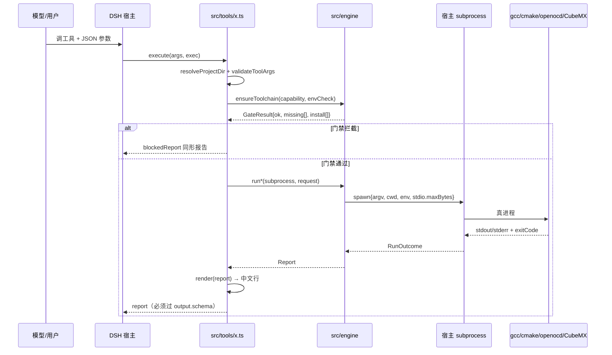

必须知道的失败面：
- **输出 schema 是硬约束**：report 多一个没声明的字段，宿主就判「非法输出」。改 report 必改 schema，并用 test/schema-guard.mjs 兜住。
- **exec.signal 一路要透传**：工具超时/用户取消 → spawn 被 abort → RunOutcome.aborted=true → report 里写「已取消」。任何一格没接 signal，取消就变成「等 30 秒超时」。
- **门禁在工具层**：engine 不知道门禁存在，所以 engine 的返回永远按「工具链就位」写文案。

### 7.2 工具链门禁：快路径、慢路径与缓存

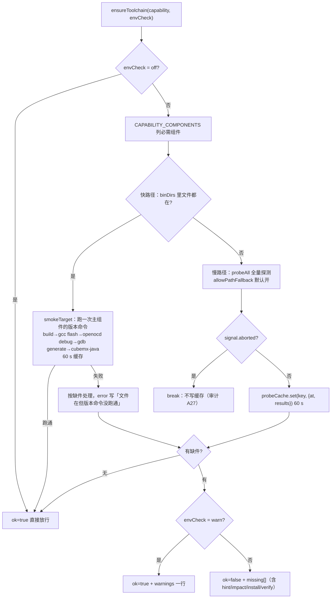

为什么快路径也要跑版本命令（审计 B13）：「文件存在」不等于「文件能跑」——半截下载、被杀软隔离、架构不对、0 字节，都表现为文件在而进程起不来。只对**主组件**做 smoke，是为了保住快路径「零全量 spawn」的价值；其余组件坏了慢路径照样兜住。

### 7.3 project_create：两条完全不同的路线

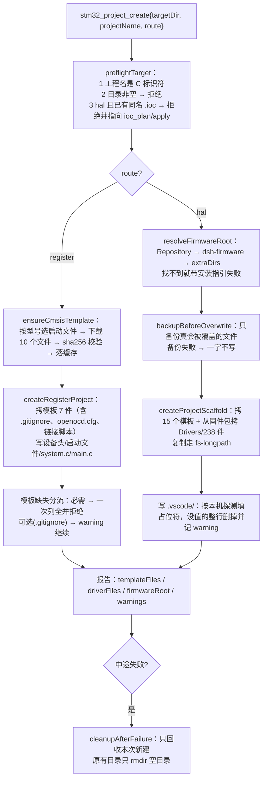

两条路线的共同点只有「先预检、再备份、失败回收」。区别是 hal 依赖 CubeMX 固件包（无网也能用整目录拷贝），register 依赖网络下载 CMSIS（但缓存命中后完全离线）。

### 7.4 build：preset → 编译 → 产物

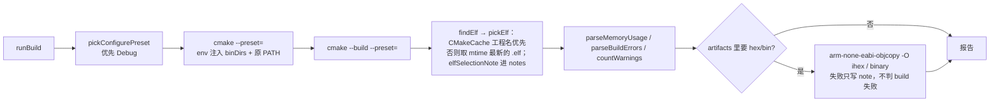

选哪个 .elf 是 0.1.2 修的坑：老的 findElf 取 readdir 的第一个，Debug 目录里积了多个 elf（改过工程名、重建过、复制过 build/）时会挑到旧的——烧进去的固件和源码不一致，却什么都不报。现在 `pickElf` 先读 CMakeCache 的 `CMAKE_PROJECT_NAME`（buildDir 目录名是 Debug，与 Debug.elf 永不相等，这条老逻辑不再被依赖），取不到再退化为 mtime 最新；候选多于 1 个时 `elfSelectionNote` 把「选了哪个 + 其余候选的 mtime」写进报告 notes，flash / debug_run / build 都会带这条说明。

坑：**复制过的工程**（CMakeCache 里记着别的路径）会报奇怪的错，build.ts 里有显式拦截：检测到 CMakeCache 的源目录与当前工程不一致就直接给「把 build/ 删掉重配」。

### 7.5 flash：守卫 → 烧录 → 判定 → 错误分类

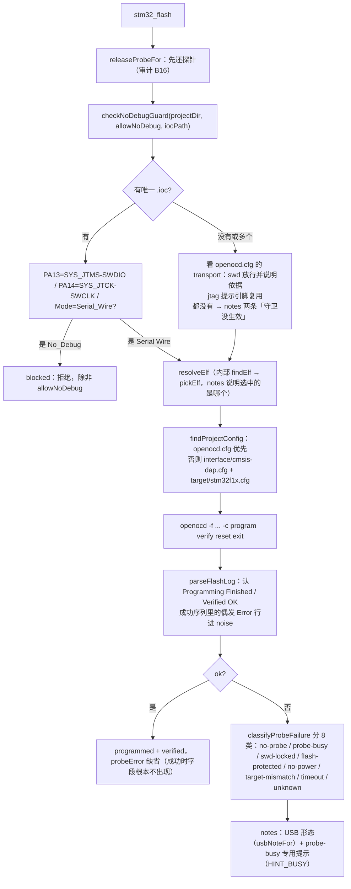

真板子取证过的一个细节：两个进程同时访问同一个 CMSIS-DAP 时，日志不是「设备忙」，而是交替出现 CMSIS-DAP command mismatch / transfer count mismatch / Failed to write memory at 0x00000004。所以 probe-error.ts 的 MATCHERS 里专门把这几种行归到 probe-busy（`/cmsis-dap (transfer count mismatch|command mismatch)|cmsis-dap command cmd_\w+ failed|libusb_error_busy/`）。

### 7.6 调试三件套与会话租约

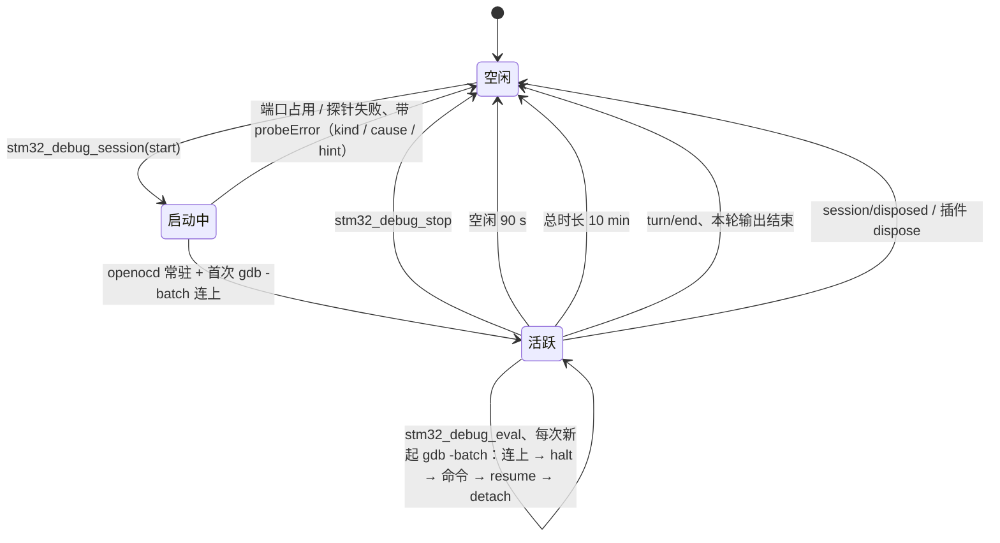

三条设计理由：
1. **只有 openocd 常驻**，gdb 每次短命——gdb 崩了不会把会话带死，也避免 gdb 自己攒一堆状态。
2. **归属（A9）**：turn/end 事件里尽量掏 agent id，只关这条会话自己开的；掏不到就全关（宁可按最短释放，也不攥着探针）。
3. **别人要用探针先 releaseProbeFor**：flash / debug_run 在自己起 openocd 之前调它，否则就是「两个 openocd 抢一个 CMSIS-DAP」。**regs_read 是例外（B3 起）**：它反过来复用会话里的那个 openocd，连读时不再一读一起一停。

B3 的快路径不是「gdb -batch 跑快一点」，而是绕开 gdb：会话里 openocd 的 Tcl RPC 端口（`debug-session.ts` 的 `parseListeningPorts` 从启动日志的 `Listening on` 行取，`TCL_PORT_SETTLE_MS = 120` 后拿完整缓冲再解析一次，存进 `session.tclPort`；`probe-session.ts` 只消费它）上一条 TCP 连接依次发 halt → `reg pc` → `mdw`×N → resume，帧用 0x1a 分隔（`readWordsViaSession`）。假探针实测：旧的一次性路径 1493 ms/次；新路径起会话 790 ms（第一次含启动），之后 10 连读单次 13–18 ms、总计 154 ms，openocd 进程数 1。没有 tcl 端口或 RPC 失败就回退到会话里的 gdb 并把原因写进 notes。**真机计时还欠着**：现插的 WCH-Link（VID_C251&PID_F001）openocd 0.12 init 直接报 `Error: CMSIS-DAP command CMD_INFO failed`，换回 CMSIS-DAP 探针后跑 `stm32_regs_read` 连读 10 次 0x4001100C 即可复测。

B4 的断点预算在同一条 execute 里先算（`resolveBreakpointBudget` 读 .ioc 的 Mcu.CPN → chips.json 的 breakpoints/watchpoints，缺就按 F1 默认 6 硬件断点 / 4 观察点并说明原因），超限在 spawn openocd **之前**就失败——不占探针、也不关你正开着的会话；报告里 `breakpoints` / `watchpoints` 各是 `{used, limit, remaining}`。

**debug_run 失败时说什么**（0.1.2 修复）：以前只回一句「openocd 起不来」外加日志最后 15 行，真正的原因（adapter init 失败、探针被占）常被后面的噪声挤掉。现在改成和 flash **同一个函数** `classifyProbeFailure`（stage "debug"，同一组 kind）归类，hint 也从 probe-error.ts 那一份来，`probeMissingLines` 命中时顺手跑 `usbDiagnosis` 分清「没插 / 没认到 / 驱动异常」，日志改用 `keyLogTail` 挑有信息量的行，`firstProblemLine` 把首条根因写进 errors，kind 不是 unknown 时把 hint 也塞进 notes。

报告里的 `probeError` 是**结构化对象**（`kind` / `cause` / `hint` / `evidence` / `retryable`），由 `PROBE_ERROR_SCHEMA` 声明（additionalProperties:false、五个字段 required）。注意一个宿主层细节：引擎在成功路径上给的是 `null`，而宿主 schema 不接受 null——所以 tools/flash.ts 与 tools/debug.ts 最后都过一遍 `flashReportForHost` / `debugReportForHost`，把 null 摘掉，让「成功时字段不出现」这件事真的成立。漏这一步就会重演 flash 那次「失败路径被判非法输出」。

### 7.7 .ioc 事务：plan → 用户确认 → apply / rollback

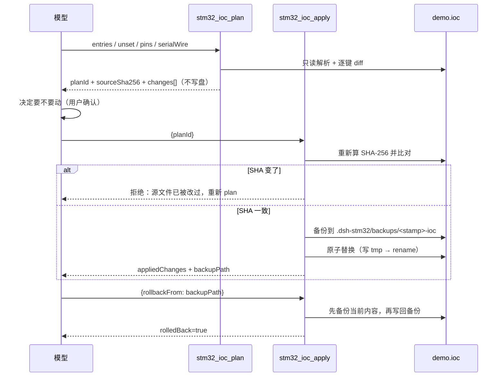

.ioc 是唯一的「配置真相」，所以它有三重保护：**不写盘的计划阶段**、**SHA 校验**、**每次写前都备份**。引脚写入保序（审计 A3）也是为这条服务的：无意义的顺序抖动会让 diff 看起来像改了很多东西。

### 7.8 generate：CubeMX 无头模式的全流程

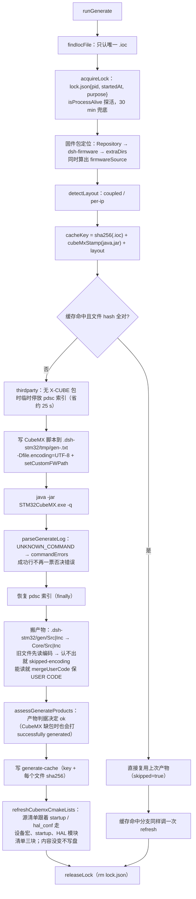

四个坑：
- **源清单不会自己长**：CubeMX 只重写 `Core/` 下的代码，`cmake/stm32cubemx/CMakeLists.txt` 它一个字都不碰。`.ioc` 里新开 USART1 后 `hal_conf.h` 会有 `HAL_UART_MODULE_ENABLED`，但清单里没有 `stm32f1xx_hal_uart.c` → 编译通过、链接报 `undefined reference to HAL_UART_Init`。所以 generate 落位之后（以及缓存命中直接返回之前）都必须跑一次 `refreshCubemxCmakeLists`（docs/development-notes.md §26，带真工具链差分验证）。
- **锁的探活**：早期只看 pid+时间，进程崩了要等 30 分钟；现在先 isProcessAlive(pid)，死了立刻接管（审计 A14）。
- **成功日志不等于成功**：CubeMX 缺固件包/包版本不认时也打 Code successfully generated，所以 ok 必须有产物判据（审计 A10）。
- **中文路径**：脚本按 UTF-8 写且启动 java 时指定 -Dfile.encoding=UTF-8（审计 B18）；否则中文工程路径在脚本里变乱码。

### 7.9 code_patch：只改块内，按字节写回

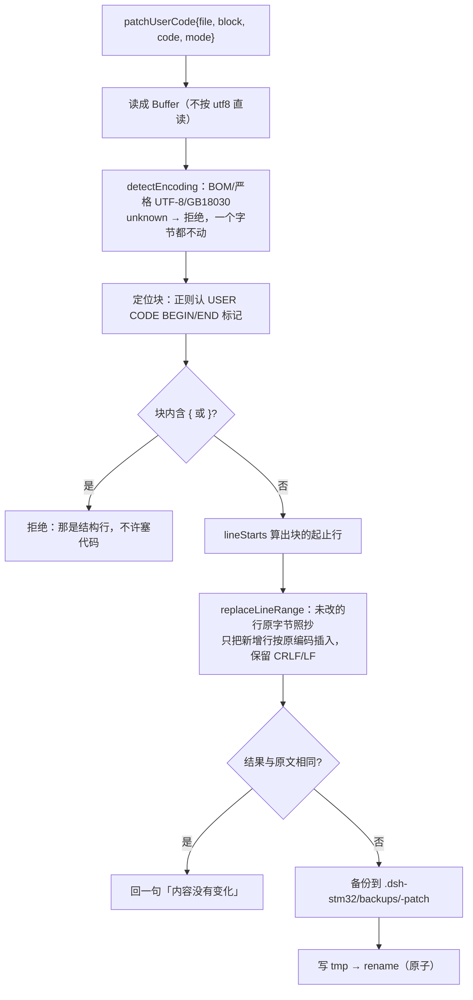

为什么要字节级拼接而不是「读成字符串再写回」：GB18030 的文件 Node 能解不能编，整份重新编码会把用户的中文注释写成问号。现在的策略是「动的只有块内那几行，其余字节原样搬运」。

### 7.10 firmware_install：选址、下载、组装、记录

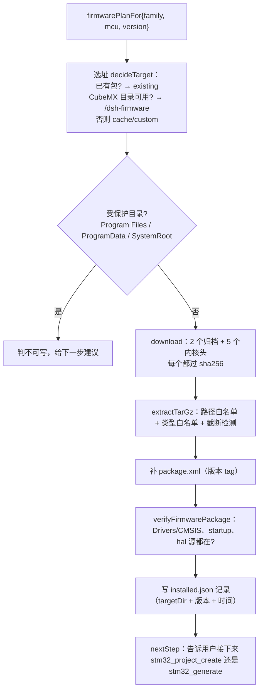

为什么装到 <CubeMX>/dsh-firmware 而不是塞进官方 Repository：CubeMX 会静默忽略自造版本号的包；真正生效的是生成脚本里的 project setCustomFWPath。所以「包放哪」和「CubeMX 认不认」是两件事——这一点写在 docs/development-notes.md §14.1。

### 7.11 env_install 的计划模式：只报缺件

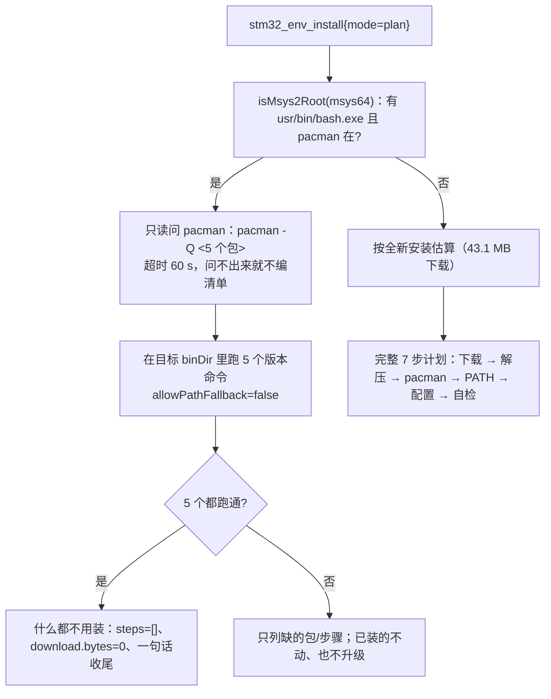

两条原则：**计划模式绝不写盘**（只读 pacman query + 只读版本命令），**已经就位的东西不列**（用户明确提过：工具链完整时卡片不该再显示 43.1 MB）。

### 7.12 export：把工程打成 zip

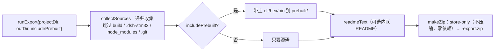

为什么 zip 里一定没有 build/：CMakeCache 记着本机的绝对路径，带过去只会在别人机器上报错。所以导出的是「能重新配置的源码」，不是「能直接烧的构建目录」。

### 7.13 设置面板：浏览器 bundle 到宿主 API

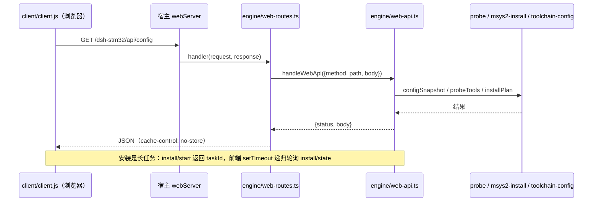

三个契约：**路由全是 exact**（不抢别的前缀）、**请求体上限 1 MB**、**任务表在进程内**（宿主重启就丢，前端会显示「任务不存在」并允许重新发起）。前端只 require 外壳种子（react / jsx-runtime / primitives），不经打包器，因为宿主以 /plugins/dsh-stm32/client.js 直接提供。

### 7.14 斜杠命令：切词 → 门禁警告 → 调 engine

```mermaid
flowchart LR
  A["/stm32-flash \"C:/Users/zhang san/proj\" --no-debug"] --> B["tokenizeCommandLine<br/>引号内不切、剥引号、记 quoted"]
  B --> C["parseInvocation：第一个非 flag token = 工程目录"]
  C --> D["commandGateWarning(capability, warn)<br/>缺件只警告不拒绝"]
  D --> E["engine（与工具同一个函数）"]
  E --> F["CommandResult{kind: success|error, text}"]
```

命令是「用户手打的快捷方式」，所以它的门禁是 warn：用户可能就想让插件跑起来看看报什么错。工具是「模型调的」，门禁才是 block。

## 8. 不变量与陷阱

这些条目破一条就会出真问题，改代码前先扫一眼。

| # | 不变量 | 破了会怎样 | 在哪体现 |
| --- | --- | --- | --- |
| 1 | 代码只写在 USER CODE 块内 | 下次生成被无声覆盖，编译还不报错 | skill R1/R2、usercode-merge.ts |
| 2 | .ioc 只能 plan → apply（带 planId） | 配置被手改后与 CubeMX 理解不一致 | skill R3、ioc-plan.ts |
| 3 | 不许生成 No_Debug 的 SYS | SWD 永久失联，只能 BOOT0 救 | skill R4、flash.checkNoDebugGuard、ioc.summarizeIoc 警告 |
| 4 | 覆盖文件前必须备份 | 用户代码丢失 | scaffold.backupBeforeOverwrite、ioc-plan、code-patch |
| 5 | 编码认不出就拒绝写 | 中文注释变问号 | text-file.detectEncoding、code-patch、generate 的 skipped-encoding |
| 6 | report 结构必须与 output.schema 一致 | 宿主判「工具返回非法输出」 | 每个 tools/*.ts、test/schema-guard.mjs |
| 7 | 子进程必须显式 cwd + 注入 env | 新装的工具链找不到 | subprocess-runner.ts、tool-env.ts |
| 8 | 动探针前先 releaseProbeFor | 两个 openocd 抢一个探针 | flash / regs / debug_run 入口 |
| 9 | turn/end 必须把探针还回去 | 用户在 VS Code 里按 F5 失败 | src/index.ts |
| 10 | 取消时不得写缓存 | 取消后仍走「已探测」假象 | toolchain-gate（A27） |
| 11 | 长路径走 \\?\ 前缀 | 深目录复制 ENAMETOOLONG | fs-longpath.ts |
| 12 | 解包走路径与类型白名单 | zip-slip / 设备文件写进系统 | tar.ts |
| 13 | 缓存索引写入可恢复 | 半截索引导致缓存全废 | cache.ts（broken/bak + CacheIndexWriteError） |
| 14 | 门禁快路径也要 smoke | 「文件在但跑不起来」被判齐全 | toolchain-gate（B13） |
| 15 | 安装自检不许 PATH 兜底 | 用系统里的旧工具冒充新装 | probe 的 allowPathFallback=false |
| 16 | 计划模式绝不写盘 | 用户以为只是看一眼，结果被改了 | msys2-install / firmware-install 的 plan 分支 |
| 17 | 模板里不许出现开发机绝对路径 | 新工程 F5 直接失败 + 泄露用户名 | vscode-config.ts + templates/ |
| 18 | 生成成功以产物为准，不以日志为准 | 缺包时误报成功 | generate.assessGenerateProducts |
| 19 | 生成期间 pdsc 停放必须在 finally 还原 | 用户的第三方包索引「消失」 | thirdparty.ts + generate.ts |
| 20 | 零运行时依赖、lib/ 入库 | 装上就坏 / 用户机器没有编译器 | package.json、tsconfig |
| 21 | cmake 源清单必须跟着 startup 与 hal_conf 走 | 开了外设也链接失败（undefined reference to HAL_xxx_Init） | cmake-sources.refreshCubemxCmakeLists、generate.ts 两处调用 |
| 22 | 链接脚本按 `<DeviceId>` 命名，命令行上只能有一个 `-T` | 链接的是别人的 MEMORY：编译过、烧到小容量芯片上跑飞（.ld 说 256 KiB，实际只有 64 KiB） | hal-chip.pointLinkerFlagAt、register-linker.renderLinkerScript、doctor.checkChipConsistency ①③ |

## 9. 测试体系

### 9.1 三层

| 层 | 位置 | 说明 |
| --- | --- | --- |
| 单元/契约 | test/*.test.mjs + test/schema-guard.mjs | 34 个套件 497 例（schema-guard 25 例），全部离线：假 subprocess、假 fs、固定夹具。**这是回归的主力** |
| e2e 脚本 | test/e2e-*.mjs（15 个） | 开发期手动跑的端到端（真 CubeMX / 真 openocd / 真工具链），不进 npm test |
| 发布形态 | scripts/pack-smoke.mjs（npm run test:pack）+ scripts/pack-size.mjs（npm run test:size） | npm pack → 解包 → 断言 16 个必须文件 → 用解包出来的 lib 真建一个寄存器工程；pack-size 再守包体（tarball ≤1.2 MB、templates/** ≤60 KB、包内禁二进制、必需文件齐全）。CI 上两连跑 |

### 9.2 34 个套件一览（test/run-units.mjs 的 suites 数组顺序）

build-units、cache-units、cache-gc-units、assets-units、probe-error-units（23 例）、probe-session-units（16 例）、breakpoints-units（17 例）、stm32f1-units、hal-route-units、clock-units、doctor-chip-units、cmake-sources-units、commands-units、doctor-regs-units、engine-units、export-units、firmware-units、flash-units、generate-cache-units、ioc-plan-units、install-units、ioc-units、route-plan-units、scaffold-patch-units、search-roots-units、session-units、text-encoding-units、thirdparty-units、tool-contract-units、toolchain-units、vscode-units、web-api-units、xcube-units、schema-guard。

开发机上 497 例全跑；CI 上是 **495 pass + 2 skipped**（两条用例依赖本机路径）。B 阶段一次加了三个套件：`probe-error-units`（23 例，8 类 kind 与判定顺序）、`probe-session-units`（16 例，会话复用与 Tcl 分帧）、`breakpoints-units`（17 例，6/4 预算与超限文案）。

约定：
- 测试 import ../lib/，所以**改 src 必须先 npm run build**（否则测的是旧代码，最容易自欺的地方）。
- run-units 用 DSH_STM32_NO_CONFIG=1 跑子进程，避免开发机上真实的 ~/.dsh-stm32/config.json 影响断言。
- 输出解析认四种结尾（node:test spec / tap / 自写 tests N / fail M / inline）；解析不到用例数会标红，而不是默默算 0。
- 套件退出码非 0 一律算失败，即使它自己打印 fail=0。
- 加套件必须手改 test/run-units.mjs 的 suites 数组——没有自动发现。

### 9.3 单测的两种假件套路

```ts
// 套路一：假 subprocess —— 按命令内容返回脚本化输出
const fake = {
  async resolveExecutable(cmd) { return cmd; },
  spawn(spec) { /* 按 spec.argv 决定往 stdout 写什么 */ },
};

// 套路二：假 fs / 临时目录 —— 真写盘到 os.tmpdir()，测量真实的备份、编码、原子替换
```

凡是「决定行为的分支」都要有脚本化的输出样本，样本**必须是上游真实格式**（审计期间踩过：按文件名猜 CMSIS 守卫宏，测的是假世界）。

## 10. 要改东西时动哪里

| 想做的事 | 动这些文件 | 别忘了 |
| --- | --- | --- |
| 加一个工具 | src/engine/<域>.ts（逻辑）→ src/tools/<x>.ts（schema + 渲染）→ src/index.ts 注册 | output schema、formatXReport、test/tool-contract-units、schema-guard |
| 改报告字段 | src/tools/<x>.ts 的 reportSchema + 渲染 | schema-guard 必须有对应断言 |
| 加芯片族（F4/G0…） | src/data/cmsis-sources.ts（启动文件与宏）、firmware-packages.ts（FIRMWARE_FAMILIES 的仓库名要 curl 核实）、data/chips.ts（引脚存在性交给 deriveChipPinTable 从本机 db 派生）、设备事实（资源仓库的 device/<族>/chips.json，由它的 scripts/build-assets.mjs 生成）、再补一份 clock-f1 那样的时钟上限表（否则寄存器版只能不出 clock_init） | 仓库名不能猜；sha256 逐文件实测并把来源 URL 记进表里（F1 的 14 条就是这么来的） |
| 加芯片型号（同族容量档） | **资源仓库的 device/f1/chips.json**（`node scripts/build-assets.mjs` 从本机 CubeMX `db/mcu` 展开 CPN 并逐字段对账，manifest 里会列 skipped）→ 插件的 src/data/device-facts.ts 自动读到；再对照 src/engine/hal-chip.ts（渲染启动文件/宏/.ld/.ioc）→ register-template.ts / register-linker.ts / register-clock.ts | 资源仓库改完要升 manifest 版本（插件按最新已装版本读）；本地 `~/.dsh-stm32/assets/` 是旧版就先 `stm32_assets refresh`。三条路都要试：HAL 建工程、寄存器建工程、doctor 一致性 |
| 改时钟树 | src/data/clock-f1.ts（PLL 源/分频/外设→总线）→ src/engine/clock-plan.ts（枚举/就近/diff）→ src/tools/ioc-plan.ts（参数与渲染）→ src/engine/register-clock.ts（寄存器版） | clock-units 14 例兜「60→64」「超限一个键都不写」；派生键必须全量重算 |
| 更新设备事实（芯片表） | **资源仓库** `node scripts/build-assets.mjs` 重跑 → device/f1/chips.json + memory.json + manifest.json 一起更新；插件侧 `stm32_assets refresh` 拉新版本 | 生成物不要手改；插件已经不再内置芯片表（`scripts/gen-chip-table.mjs` 与 chip-table.json 2026-10-31 删除），没缓存时工具会明说先 refresh。测试夹具在 `test/fixtures/assets/`，与真实资源包同构 |
| 改工程模板 | templates/scaffold/*，若新增文件同步 scaffold.ts 的 SHARED_TEMPLATE_FILES | scaffold-patch-units 的文件数断言会红 |
| 改设置面板 | client/client.js（前端）+ engine/web-api.ts（逻辑）+ web-api-units | 前端不经打包器，语法要保守 |
| 改编码行为 | engine/text-file.ts 一处改，code-patch / generate 自动跟随 | text-encoding-units 9 例兜底 |
| 改 .elf 选择规则 | engine/build.ts 的 `pickElf` / `elfCandidates` / `elfSelectionNote`（flash、debug_run、doctor、export 全都间接用它） | build-units 里要同时断言「工程名优先」和「退化到最新」两条路 |
| 加 / 改探针错误分类 | engine/probe-error.ts 的 `classifyProbeFailure` 与 `PROBE_ERROR_KINDS`（MATCHERS 顺序敏感；flash / debug / session 三条路径共用同一份） | 三处同改：probe-error 的 MATCHERS 与 hint、tools 层的 `PROBE_ERROR_SCHEMA` 声明、test/probe-error-units 与 schema-guard |
| 改 cmake 源清单的认法（设备宏、startup、HAL 模块） | engine/cmake-sources.ts 的 `collectCmakeSources` / `halModulesInUse` | 注释掉的 `#define` 与 `#include` 不能算启用；内容没变必须零写入（cmake-sources-units 15 例兜这两条） |
| 加一条不变量 | 先写测试，再改代码 | 本文件第 8 章同步补一行 |

## 11. 已知的坑与未做的事

1. **只有 F1 在 FIRMWARE_FAMILIES**：其他族要接入必须先核实真实仓库名（stm32g4xx-hal-driver 之类），不能照 F1 改字母。
2. **generate 是否补发 SetCopyLibrary "copy all"** 仍待定：只靠 .ioc 的 ProjectManager.LibraryCopy=1 不会让 CubeMX 从 setCustomFWPath 的包拷 HAL 源码。
3. **firmware-install 的 existing 分支 nextStep 文案**偏旧（还停在「直接调 stm32_generate」的说法）。
4. **四类探针故障只有单测没有真机**：swd-locked / flash-protected / no-power / target-mismatch 需要真故障才能验（`probeError` 的 kind 与专属 hint 已在 test/probe-error-units 覆盖）。
5. **P2（多芯片 + HAL 外设源文件按需落位）与 P3（gdb MI 常驻）** 未开工。
6. **docs/diagrams/** 那两张 HTML 图有 2 MB 原始 / 891 KB gz，已经不进 npm 包**（package.json 的 files 从 docs 收窄成 docs/*.md）。这事现在由 `scripts/pack-size.mjs`（npm run test:size）守着：tarball ≤1.2 MB、templates/** ≤60 KB、包内禁 png/jpg/jpeg/gif/webp/bmp/pdf/html/zip/7z/exe/dll、必须含 README.md / README_EN.md / LICENSE / cordis.patch.yml / docs/reading-guide.md。实测包体 509.9 KB / 99 个文件。
7. **CI 上的 test:pack** 只在本机跑过；第一次在 GitHub Actions 上跑还没有记录。
8. 斜杠命令的卡片渲染只有用户手输能验，工具层测不到。
9. **.elf 的选择依赖 CMakeCache**：工程名优先来自 `CMAKE_PROJECT_NAME`，手工删了 CMakeCache 或换了构建目录后只能退化为「mtime 最新」，此时以报告 notes 里的候选列表为准。
10. **裸 `cmake -S . -B build` 会丢工具链文件**：工具链只由 `CMakePresets.json` 注入（`cmake/gcc-arm-none-eabi.cmake`），不走 preset 就得自己给 `-DCMAKE_TOOLCHAIN_FILE`，否则 configure 用宿主 gcc、链接时找不到启动文件。
11. **别用 .elf 文件大小判「超 Flash」**：带 `-g3` 的 20 KiB 固件，.elf 里有 600 KB 调试信息，按文件大小判会把正经 C8T6 工程误报成超容量。doctor 因此读 ELF program header，只累加 `p_paddr` 落在 0x08000000 起 1 MiB 的 `PT_LOAD` 的 `p_filesz`；解析不出 program header 时才退回文件大小并注明是粗算。
12. **换芯片后别留旧链接脚本名**：`-T` 出现两个 .ld 时链哪个取决于顺序，症状是「编译过、上板跑飞」。hal-chip.pointLinkerFlagAt 会把工具链里的旧名改指新名，doctor 的 ①③ 两项检查也会先报 blocker。
13. **B3 的真机计时还欠着**：会话复用快路径只有假探针（假 subprocess + 本地假 Tcl 服务端）的数字，真机 10 连读没测成——当时插的是 WCH-Link（`USB\VID_C251&PID_F001`），openocd 0.12 init 直接报 `Error: CMSIS-DAP command CMD_INFO failed.`，hid / bulk 后端与 `adapter speed 1000` 都试过；同一句在 B3 之前的旧版一次性路径上也复现，所以不是这次改动引入的。**复测方法**：换回 CMSIS-DAP 探针后跑 `stm32_regs_read` 连读 10 次 `0x4001100C`，看报告里的 `durationMs` 与 `reusedSession`。

---

读完这一遍，最值得回头再看两处的顺序是：**先 7.8（generate）再看 5.5**，因为 generate 是全仓库复杂度顶点，看懂它就等于看懂了「编码层 + 备份 + 缓存 + 产物判据 + 锁」这五条横切关注点如何在一个流程里共存。